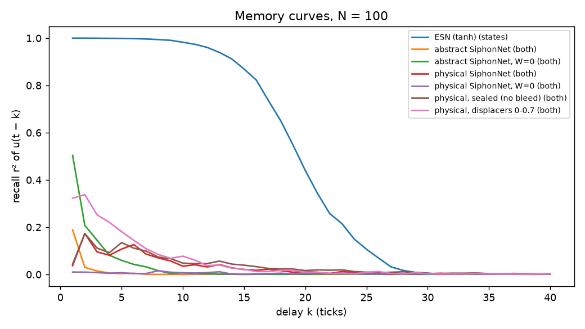

# SiphonNet

**A reservoir computer made of self-emptying water containers.**

Each "neuron" is a container with a bell siphon: it fills, and when the water reaches the
rim of the standpipe the siphon primes and empties the container in one go, down to the
level where air breaks the siphon. The discharge is split between a few other containers.
Pumps feed the input in; a linear readout trained on the containers' activity does the
classification. Nothing inside the network is trained.

The point of this project is not to propose a better neural network. A network of
leaky integrate-and-fire units with a linear readout is a well-known liquid state machine
(Maass 2002). The question here is narrower and, as far as we can tell, open:

> Can a network of passive, self-triggering hydraulic elements — no sensors, no valves,
> no electronics inside — act as a useful reservoir, and do the specific physics of a
> siphon (hysteresis, finite discharge, saturation, mass conservation) help or hurt?

## Status

Early research code. Two simulators, an honest first benchmark, and a list of what is
still missing. No physical build yet.

## Two models

### 1. Abstract (`siphonnet/abstract.py`)

The original discrete-time sketch:

```
h_i(t+1) = 0.96 · h_i(t) + u_i(t) + Σ_j M_ji · q_j(t − d_ji)
fires if h_i ≥ θ_i:   q_i = h_i,   then h_i = 0
```

θ_i ∈ [0.85, 1.15], 7 random targets per unit, 55 % of every discharge is routed (evenly),
45 % drains, one step transport delay. This *is* a leaky integrate-and-fire network with
reset to zero, graded spikes and excitatory weights only — nothing in it is specific to
siphons.

### 2. Physical (`siphonnet/physical.py`)

A bell siphon in a container of cross-section A (cm, s, mL):

```
A_eff · dh/dt = Q_pump + Q_routed − primed · Q_siphon(h) − Q_bleed(h)

Q_siphon(h) = Cd · a_tube  · √(2g (h + drop))      Torricelli, head down to the outlet end
Q_bleed(h)  = Cd · a_bleed · √(2g h)               optional hole in the floor (the only leak)

primes at h ≥ h_on,  breaks at h ≤ h_off
```

What this adds over integrate-and-fire, all of which follow from the physics rather than
being put in by hand:

| property | consequence |
|---|---|
| hysteresis (h_on > h_off) | a pulse empties only the working zone, not the container |
| finite, level-dependent discharge | pulses last seconds; inflow during a pulse lengthens it |
| saturation | if inflow exceeds the siphon's flow at h_off, it never breaks: continuous through-flow |
| no leak unless drilled | a sealed container is a perfect integrator between pulses |
| mass conservation | the routed share per siphon is ≤ 1; the network cannot amplify volume |
| non-negative signals | inputs are pump flows; signed inputs use complement coding (x, 1 − x) |
| fabrication spread | areas and trigger levels vary by a few percent, which a reservoir likes |

**Displacer pistons.** A piston occupying part of the working zone reduces the effective
cross-section. The container then fills faster *and* releases smaller pulses; mean
throughput stays the same (mass conservation), only the granularity changes. It is one
knob per container — effectively its threshold — not a per-connection weight. A piston
below h_off would only fill dead volume and change nothing. Per-connection weights would
need adjustable flow splitters under each outlet.

**Gravity.** Water only runs downhill, so a siphon can only feed containers *below* its
outlet. A passive hydraulic network therefore has **no loops at all**: it is a cascade
(`gravity_topology`: rows of containers, each siphon pours into 4 containers of the row
below, at most 2 columns sideways; the bottom row drains away). Recurrence would need
pumps lifting water back up, i.e. an energy source inside the network. The random graphs
used in the first experiments (`random_topology`) ignore this and are kept only for
comparison.

Default geometry: 10 cm² containers, h_on = 8 cm, h_off = 2 cm (60 mL per pulse),
6 mm siphon tube with a 10 cm drop (~30 mL/s), 0.6 mm bleed hole, pumps up to 6 mL/s.

## Results

Full tables: [`results/`](results/). Short version — so far the network connections add
nothing, and the siphons have very little linear memory:

**Two moons** ([table](results/two_moons.md)). Everything with a nonlinearity lands at
96–97 %, which is the noise limit of the data set. The same siphons *without any
connections* (W = 0) do exactly as well, and so do random ReLU features without any
dynamics. Beating logistic regression on raw inputs (87 %) only shows that a threshold
is nonlinear. One small positive: 10 physical siphons with level readout already reach
RBF-SVM accuracy (96.4 %).

**Linear memory capacity** ([table](results/memory_capacity.md), N = 100). A tanh echo
state network recalls inputs up to ~20 ticks back (MC ≈ 19). The abstract model with the
original parameters reaches MC ≈ 0.3, the physical model ≈ 1–2 (best with random
displacers: 2.1). The reason is structural: a container that empties at a threshold
stores its input history as a *phase* (integrate, then wrap around), which a linear
readout cannot unfold. Plain leaky integrators without the reset recall u(t − 1) with
r² ≈ 0.8 from the same inputs; the siphon reset brings that close to 0.



**Routed share** ([table](results/share_sweep.md)). The original 55 % is subcritical.
Passing on more raises the physical model's memory to MC ≈ 3.3 at 90–100 %, but then
a fifth to a half of the siphons saturate into continuous through-flow. The abstract
model runs away instead (every unit fires every step).

**Letters A–Z** ([table](results/letters.md)). 5×7 pixel glyphs, every lit pixel drives a
pump, 3 pixels flipped at random, ±20 % pump tolerance. A linear classifier on the raw
pixels gets 93.7 %. 100 siphons in a square gravity cascade get 94.3 %, 144 get 95.2 % —
the same as the random graph, and slightly *below* the same siphons without any pipes
(96.1 % / 96.5 %). A wide cascade of 5 × 20 does a little better (95.5 %,
[table](results/letters_rows5.md)): shallower means less mixing, closer to no pipes at all.
Again: the threshold nonlinearity helps a little, the connections do not (yet).

Open questions this leaves: nonlinear memory (information processing capacity, delayed
XOR) may look different from linear memory; readouts of phase (e.g. pulse timing) might
recover what levels hide; inhibition-like elements and leaky collecting basins are the
obvious hydraulic additions.

## Demo video

`video/` renders a 90-second 2D explainer (1920×1080, English or German): one siphon
filling, priming and breaking; then 100 siphons in a gravity cascade of 5 rows × 20
recognising the typed letters S-I-P-H-O-N. The 35 pumps sit above the cascade, their hoses
fan out to the containers they feed; the readout A–Z sits on the right, and after each run
gold lines show the 24 containers that pushed the winning letter's score up the most
(coefficient × standardised feature, summed per container).

Every level, pulse, hose, vote and readout score comes from the physical simulation
(`video/prepare.py`); only the look of the water streams and the droplets travelling down
the hoses is decoration. The six demo inputs are the first random noisy samples drawn
(seed 0), not picked; the readout's test accuracy (95 % for this network) is shown in the
video. Pumps feed containers in every row: feeding only the top row would look tidier but
drops accuracy to ~86 %, below a linear classifier on the raw pixels.

```bash
.venv/bin/python video/prepare.py --word SIPHON
.venv/bin/python video/render.py --lang en      # or --lang de, --stills 5,40, --scale 0.5
```

## Run it

```bash
python3.12 -m venv .venv && .venv/bin/pip install -e '.[dev]'
.venv/bin/pytest
.venv/bin/python experiments/two_moons.py
.venv/bin/python experiments/memory_capacity.py
```

## What is known, what might be new

| | |
|---|---|
| integrate, threshold, discharge, leak | known: leaky integrate-and-fire (Lapicque 1907) |
| fixed random network, trained readout only | known: liquid state machine (Maass 2002), echo state network (Jaeger 2001) |
| water as a reservoir | known: *Pattern Recognition in a Bucket* (Fernando & Sojakka 2003), water-wave reservoirs |
| threshold, topple, pass on a share, lose the rest | known: sandpile / OFC models (Bak et al. 1987; Olami, Feder & Christensen 1992), neuronal avalanches (Beggs & Plenz 2003) |
| pulse-coupled relaxation oscillators | known: Mirollo & Strogatz 1990 — they tend to synchronise, which is bad for a reservoir |
| perceptrons from water tanks | known on paper: Civiero et al. 2024 (valves switched by *measured* levels, weights as pipe diameters, no siphons, no build) |
| the Tantalus / siphon container as a nonlinear oscillator | known as dynamics, not as computing |
| **self-triggering siphons as reservoir nodes, with their real physics** | not found in the literature so far |
| **cost of hydraulic constraints** (no inhibition, non-negative, mass-conserving, local) on reservoir performance | not found as a systematic study |
| energy efficiency vs. electronics | not expected for general computing; niches where the signal is already a fluid |

## Roadmap

1. ~~Ablation and fair baselines on a static task~~ (two moons, above)
2. Temporal benchmarks: ~~linear memory capacity~~, NARMA-10, delayed XOR, spoken digits
3. Rerun memory capacity and the share sweep on gravity cascades (the tables above
   still use random graphs)
4. Sweeps: ~~routed share~~, bleed, threshold spread, cascade depth and fan-out
   and displacer distributions
5. Hardware constraints: readout of only 16–32 containers, quantised levels (camera)
6. Hydraulic readout: trained weights as flow splitters into two collecting basins (±)
7. A tabletop build: 8–16 3D-printed bell siphons, two pumps, a camera

## References

- W. Maass, T. Natschläger, H. Markram (2002). Real-time computing without stable states. *Neural Computation* 14(11).
- H. Jaeger (2001). The "echo state" approach to analysing and training recurrent neural networks. GMD Report 148.
- H. Jaeger (2002). Short term memory in echo state networks. GMD Report 152.
- C. Fernando, S. Sojakka (2003). Pattern recognition in a bucket. *ECAL 2003*, LNCS 2801.
- G. Tanaka et al. (2019). Recent advances in physical reservoir computing: a review. *Neural Networks* 115. [arXiv:1808.04962](https://arxiv.org/abs/1808.04962)
- N. Civiero, A. Henderson, T. Hinze, R. Nicolescu, C. Zandron (2024). Implementing perceptrons by means of water-based computing. *J. Membrane Computing* 6. [doi:10.1007/s41965-024-00136-1](https://doi.org/10.1007/s41965-024-00136-1)
- R. E. Mirollo, S. H. Strogatz (1990). Synchronization of pulse-coupled biological oscillators. *SIAM J. Appl. Math.* 50(6).
- Z. Olami, H. J. S. Feder, K. Christensen (1992). Self-organized criticality in a continuous, nonconservative cellular automaton modeling earthquakes. *PRL* 68.
- J. M. Beggs, D. Plenz (2003). Neuronal avalanches in neocortical circuits. *J. Neurosci.* 23(35).
- M. Stern, D. Hexner, J. W. Rocks, A. J. Liu (2021). Supervised learning in physical networks. *PRX* 11. [arXiv:2011.03861](https://arxiv.org/abs/2011.03861)
